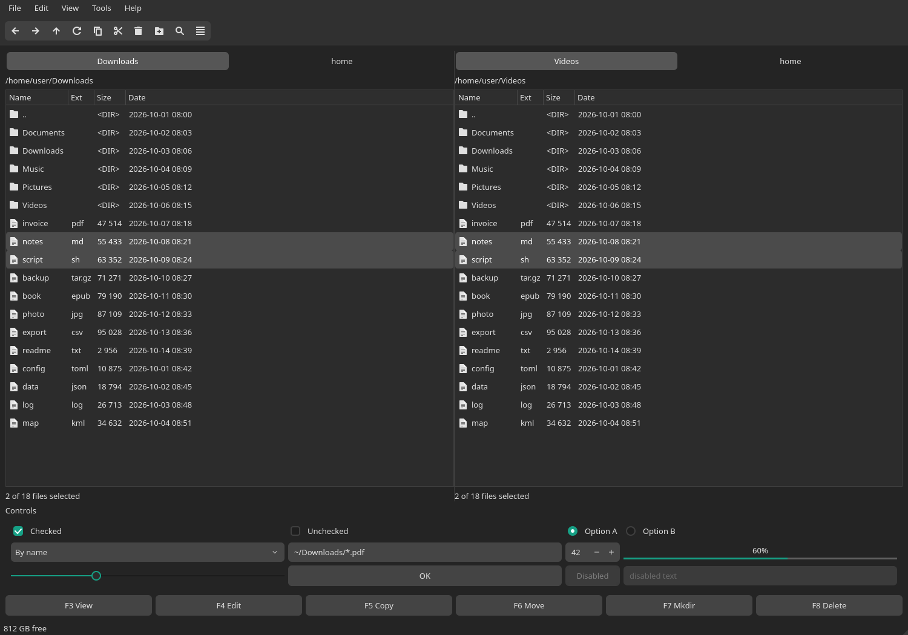
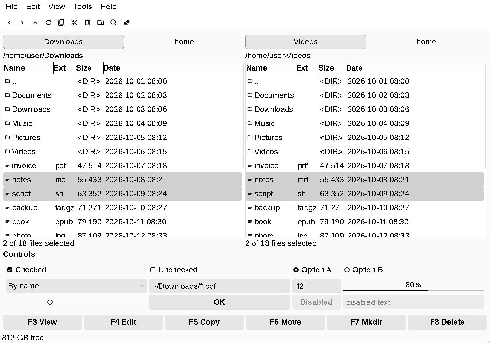
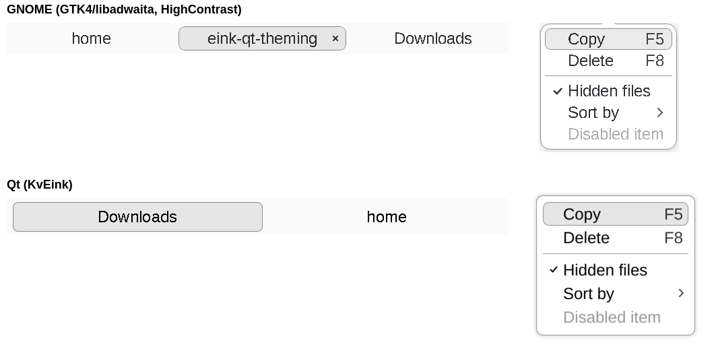
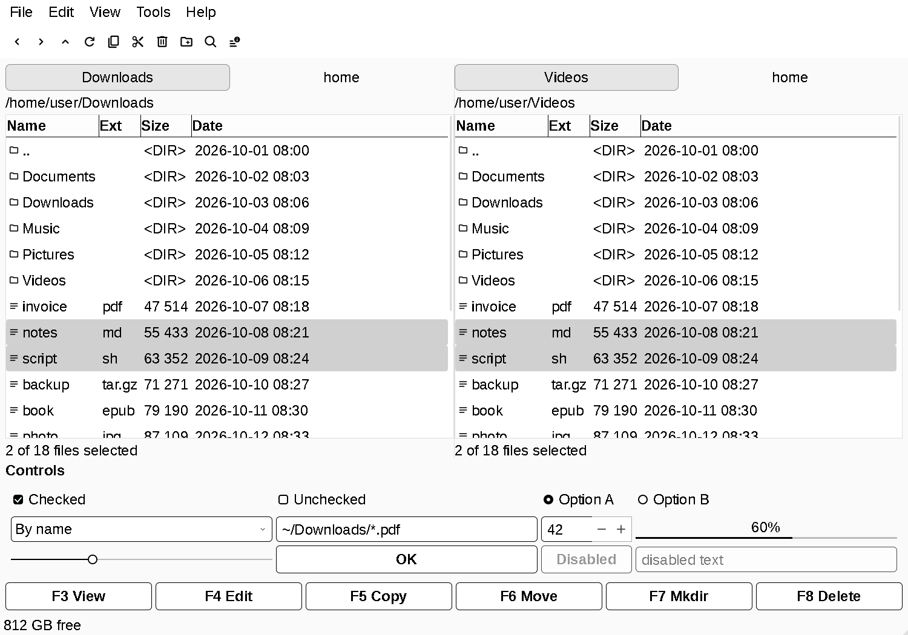
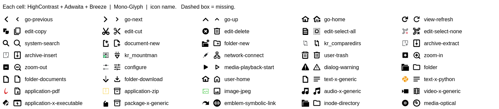

# eink-qt-theming

Black-and-white theming that makes Qt and KDE applications (Krusader, Kasts, …) legible on an **e-ink monitor** and
consistent with GNOME's HighContrast GTK apps, on GNOME or on a standalone Wayland compositor such as
[niri](https://github.com/niri-wm/niri).

| Before (Manjaro default: dark Kvantum, 10 pt) | After (KvEink) |
|---|---|
|  |  |

## What you get



- **KvEink**, a [Kvantum](https://github.com/tsujan/Kvantum) theme generated from KvLibadwaita: libadwaita's light
  grey borderless buttons and fields, black check boxes, light grey selection, bold button labels, libadwaita-style
  tabs and menus without icons. Nothing fades or animates, so scrollbars stay visible.
- **KvEinkOutline**, the same with white controls outlined in black. Switch in Kvantum Manager or with `theme=` in
  `~/.config/Kvantum/kvantum.kvconfig`.
- **Eink** icon theme: black glyphs from the [Cawnonical Mono-Glyph Icon Suite](https://store.kde.org/p/2298642)
  (Text-Fill variant), with GNOME-style title-bar buttons. Without Mono-Glyph it falls back to HighContrast,
  Adwaita and Breeze.
- **Eink** KDE colour scheme for Kirigami apps (Kasts) and KDE widgets.
- qt5ct/qt6ct set to your GNOME fonts and portal file dialogs; antialiasing off for Krusader and Kasts
  (fontconfig).
- Snippets for Krusader, niri (rounded, outlined windows) and GTK4 (a black accent colour), and settings for Kasts.

| KvEink | KvEinkOutline |
|---|---|
|  |  |



## Requirements (Arch Linux / Manjaro)

- `kvantum` (`kvantum-qt5` for Qt 5 apps), `qt5ct`, `qt6ct`, `qt6-wayland` (ships the `adwaita` title bars)
- a KvLibadwaita base theme: Manjaro's `kvantum-manjaro` (KvLibadwaitaMaia) or upstream
  [KvLibadwaita](https://github.com/GabePoel/KvLibadwaita)
- `python-pyqt6` or `python-pyqt5` (to generate the theme), `adwaita-icon-theme`, `breeze-icons`
- GNOME's font settings readable with `gsettings` (otherwise the qt5ct/qt6ct fonts are left alone) and a portal
  backend such as `xdg-desktop-portal-gnome` for the file dialogs
- recommended: Mono-Glyph Text-Fill (not packaged, see below); otherwise `gnome-themes-extra` for HighContrast icons
- `QT_QPA_PLATFORMTHEME=qt5ct`: Manjaro sets it in `/etc/profile.d/qt-theming.sh`; elsewhere set it yourself, e.g.
  in `~/.config/environment.d/qt.conf`. qt6ct answers to it too.

## Install

For the black icons, first download `Cawnonical-Mono-Glyph-Icon-Suite-Text-Fill.tar.gz` from the *Files* tab of
<https://store.kde.org/p/2298642>.

```sh
mkdir -p "${XDG_DATA_HOME:-$HOME/.local/share}/icons"
tar -xf Cawnonical-Mono-Glyph-Icon-Suite-Text-Fill.tar.gz -C "${XDG_DATA_HOME:-$HOME/.local/share}/icons"
git clone https://github.com/jiri-one/eink-qt-theming.git
cd eink-qt-theming
./install.sh        # or: ./install.sh ~/src/KvLibadwaita/src/KvLibadwaita
```

`install.sh` generates both Kvantum themes and the icon theme, installs the colour scheme and the fontconfig rule,
and sets kdeglobals, qt5ct/qt6ct and Kvantum, changing only its own keys. Replaced files are backed up to
`~/.local/state/eink-qt-theming/backup-*`, together with a list of the files it created.

Then, as far as they apply to you:

1. **Title bars outside GNOME**: Qt uses the adwaita decoration only when `XDG_CURRENT_DESKTOP` contains GNOME, so
   set `QT_WAYLAND_DECORATION=adwaita`. On niri add [`config/niri.kdl`](config/niri.kdl) to your niri config (it
   also rounds and outlines all windows like libadwaita's; put its window rule before yours and turn the focus
   ring off). Add [`config/bash_profile`](config/bash_profile) to your login shell's profile too, so apps started
   through D-Bus get the variable.
2. **Krusader**: append [`config/krusader-colors.ini`](config/krusader-colors.ini) to `~/.config/krusaderrc` while
   Krusader is closed.
3. **Kasts**: while Kasts is closed set `headerSize=0` in `~/.config/KDE/kasts.conf`, and pick the *Eink* colour
   scheme in its settings (`[UiSettings] ColorScheme=Eink` in `~/.config/kastsrc`).
4. **GTK4 apps**: add [`config/gtk-4.0/gtk.css`](config/gtk-4.0/gtk.css) to `~/.config/gtk-4.0/gtk.css` for a black
   accent colour.
5. Restart your applications.

## Notes

What didn't work, and why the theme is built the way it is.

- **gtk3 platform theme.** `QT_QPA_PLATFORMTHEME=gtk3` copies GTK's HighContrast palette (pin it with
  `QT_GUI_GTK_JSON`), but the widgets stay Fusion. Don't combine it with Kvantum: the whole app ends up in the
  monospace font, because `QGtk3Interface::font()` leaves the `monospace` class on a shared GTK style context.
- **Title bars.** Without `QT_WAYLAND_DECORATION=adwaita`, Qt outside GNOME draws the plain "bradient" decoration.
  The adwaita one takes its font from the platform theme (qt6ct: the general font). For its buttons it doesn't use
  `QIcon` but scans icon directories named after `QIcon::themeName()` (`KIconEngine` in KDE apps), the fallback
  theme and `Adwaita`, hence `~/.local/share/icons/KIconEngine/`. The ring around each button lies outside the
  SVG's view box and would leave specks in ordinary icon use, so those files sit in a directory the icon theme
  doesn't declare.
- **KDE icons.** `KIconLoader` ignores `Context=UI` directories and rejects a theme without a valid directory,
  falling back to Breeze; the Eink theme declares an empty `Context=Actions` one.
- **Menus.** qt6ct's `menus_have_icons=false` has no effect on Qt 6.11, which takes the setting from the platform
  theme's `ShowIconsInMenus` hint; KvEink uses Kvantum's `iconless_menu` instead. libadwaita menus have 32 px
  items, a highlight rounded by 9 px and popovers rounded by 15 px with a 7 px gap to the items. Kvantum never
  makes an item lower than the font height + 8 px and can't round a menu more than its frame, so KvEink uses
  10 px for both. The 9 px highlight comes from an `expand-` element, which Kvantum draws with corners of half
  `frame.expansion`. Composited menus take their frame and shadow from `menu-shadow-*`, sized by
  `menu-shadow-hint-*`, not from `menu-normal-*`.
- **KDE colour schemes.** Outside Plasma, `KColorSchemeManager` picks Breeze or Breeze Dark (KF 6.29: only the
  platform palette in high contrast) unless `[UiSettings] ColorScheme` is set, and an app's own rc file wins over
  kdeglobals. Kirigami colours come from the scheme, not the Qt palette; `frameContrast=1.0` makes its separators
  black.
- **Krusader.** With the default KDE colours the current file has only a dotted focus frame, so the colours are
  custom. Normal rows use `AlternateBase`, which must be white too. Krusader 2.9 doesn't recolour file icons, so a
  black icon vanishes on the black cursor bar; its development branch tints Mono-Glyph's Text-Fill icons.
- **Accent colour.** Any GNOME accent colour shows as mid grey on e-ink (Maia green `#16a085` is about `#808080`)
  under white check marks and labels. libadwaita fills only those with the accent and tints selections and focus
  rings with it, so black gives crisp controls and a readable `#bfbfbf` selection.
- **Kasts.** Its player header hard-codes dark colours in QML; collapsing it (`headerSize=0`) leaves a light bar.
- **Fonts.** On Wayland, Qt takes antialiasing and hinting only from fontconfig; `<test name="prgname">` scopes a
  rule to one program.
- **Flatpak.** A Flatpak with the same desktop file ID as the native app wins in launchers and sees none of these
  settings except kdeglobals.

## Previewing changes

[`tools/preview/gallery.cpp`](tools/preview/gallery.cpp) renders a widget gallery and a menu to PNG with Qt's
offscreen platform; point `XDG_CONFIG_HOME` at a scratch directory to try a theme without installing it. The
offscreen platform has no compositor, so for menus as you see them use
[`tools/preview/menugrab.cpp`](tools/preview/menugrab.cpp), which renders through Wayland without opening a window.

```sh
g++ -std=c++17 -fPIC tools/preview/gallery.cpp -o /tmp/gallery $(pkg-config --cflags --libs Qt6Widgets)
QT_QPA_PLATFORM=offscreen QT_QPA_PLATFORMTHEME=qt5ct /tmp/gallery /tmp/gallery.png
g++ -std=c++17 -fPIC tools/preview/menugrab.cpp -o /tmp/menugrab $(pkg-config --cflags --libs Qt6Widgets)
QT_QPA_PLATFORM=wayland /tmp/menugrab /tmp/menu.png
```

## Uninstall

The oldest directory in `~/.local/state/eink-qt-theming/` holds the state before the first install: delete the
files listed in its `created-by-install.txt` and copy the others back (their paths are relative to your home
directory). Then remove Mono-Glyph if nothing else uses it and undo the manual steps above.

## License

Copyright (C) 2026 jiri-one. GPL-3.0-or-later. KvEink is generated from KvLibadwaita; the default base, Manjaro's
KvLibadwaitaMaia (`kvantum-manjaro`), is GPL-3.0-or-later and upstream KvLibadwaita is GPL-3.0. The Mono-Glyph
icons (GPL-3.0) are not part of this repository.

## Credits

[Kvantum](https://github.com/tsujan/Kvantum) by Tsu Jan, [KvLibadwaita](https://github.com/GabePoel/KvLibadwaita)
by GabePoel (whose configuration credits Vince Liuice and Tsu Jan's KvAdapta) and Manjaro's KvLibadwaitaMaia, the
control shapes of [adwaita-qt 2.0](https://github.com/victorvintorez/adwaita-qt), a continuation of
[FedoraQt/adwaita-qt](https://github.com/FedoraQt/adwaita-qt), the
[Cawnonical Mono-Glyph Icon Suite](https://store.kde.org/p/2298642), GNOME's HighContrast and Adwaita icons, and
KDE's Breeze icons.
